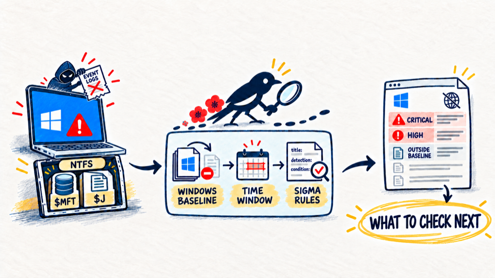

<p align="center"></p>

# Mozu

**Find what to look at on a Windows host, even after the event logs were wiped.**

Reads `$MFT` and the USN journal of one Windows host and writes one HTML report of the files to check first. Built for the first look after a ransomware or EDR alert, by responders who are not forensic specialists.

> Pre-alpha. Phases 1–3 of the [plan](docs/plan.md) are built; their gates are pending. Interfaces may change.

## Even without event logs, find the next file to check

Even when event logs are deleted, NTFS metadata can still provide leads. Mozu subtracts a Windows baseline, focuses on the incident window, and applies Sigma rules to show what to check next.

<p align="center"></p>

## Why Mozu

| Problem | Mozu |
|---|---|
| Event logs were wiped | Reads only `$MFT` and the USN journal, which survive log clearing |
| Normal Windows activity drowns the signal | Hides files a clean Windows also has; unknown files stay visible |
| MFT parsers give CSV with no guidance | Shows Sigma rule matches you can read. No scores |
| Full forensics takes days | Collects a zip of tens to hundreds of MB |
| Results are hard to share | One offline HTML report from one binary |

## How it works

1. **Collect** on the Windows host, in an elevated shell. You get a zip with `$MFT` and `$J`.

   ```powershell
   mozu collect -o D:\host.zip
   ```

2. **Analyze** on any OS. Unzip first, then point Mozu at the files, a [baseline](docs/quickstart.md#4-baseline) and the rules:

   ```sh
   mozu analyze -i 'host/$MFT' --usn 'host/$J' \
     --baseline win11.fst --rules testdata/rules -o report.html
   ```

3. **Open** `report.html` in a browser. It works offline.

Every step in detail: [quick start](docs/quickstart.md).

## What it cannot tell you

- Who or which process created a file, or whether it ran
- File content
- Activity older than the USN journal
- "Outside baseline" is a lead, not proof of compromise

## Not yet

Reading the zip or a collection directory directly (extract it first), ready-made baselines, correlation rules, Timeline and File detail screens, Japanese UI (Phase 4). USN V4 records are reported, not parsed.

## Docs

| | |
|---|---|
| [Quick start](docs/quickstart.md) | Build, collect, analyze, open the report |
| [Use cases](docs/usecases.md) | Step-by-step recipes |
| [Product](docs/product.md) | Problems, users, MVP |
| [Architecture](docs/architecture.md) | Pipeline, output columns, rule support |
| [Plan](docs/plan.md) | Current phase and next items |
| [AGENTS.md](AGENTS.md) | Development rules |

## License

- Code: [AGPL-3.0-only](LICENSE)
- Detection rules: [DRL 1.1](https://github.com/SigmaHQ/Detection-Rule-License)
